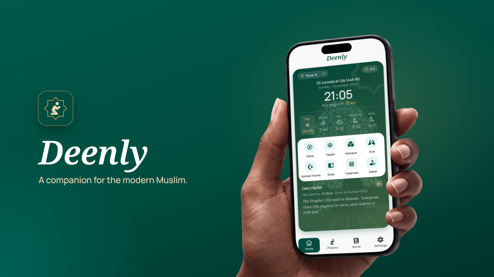
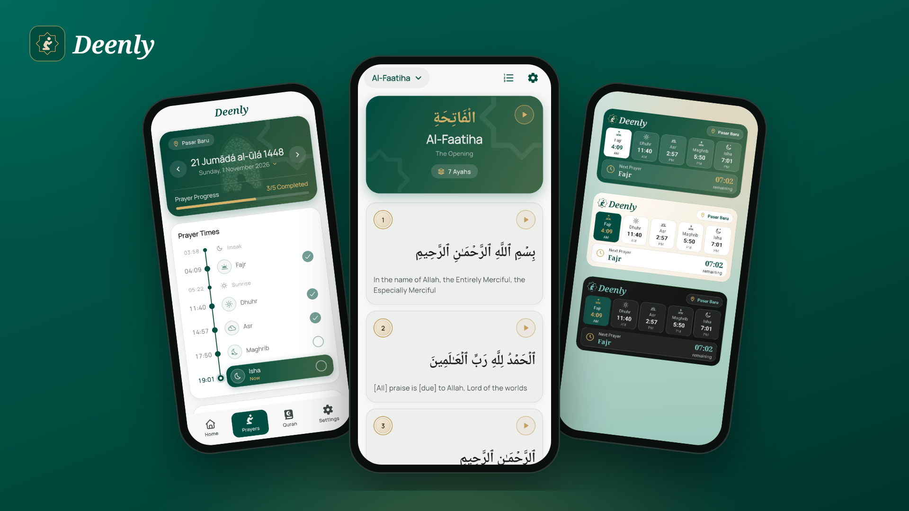

# Deenly 🌙

**A companion for the modern Muslim.**

Deenly is an Islamic companion app built with Flutter that helps Muslims fit their daily worship naturally into modern life. It brings accurate, location-based prayer times, the Quran with audio recitation, Qibla direction, morning and evening dhikr, daily duas, a Hijri calendar and zakat calculators together in one calm, carefully designed app, with a home screen widget, reliable reminders and full support for English and Bahasa Indonesia.

<p align="center">
  
</p>

<p align="center">
  
</p>

## ✨ Features

- **📍 Precise Prayer Times**: Automatically calculates accurate prayer times based on your current geographical location.
- **🧭 Qibla Compass**: A beautiful and accurate compass to help you find the Qibla direction from anywhere in the world.
- **📖 Digital Quran**: Read and reflect on the Holy Quran with a clean, readable interface.
- **📿 Tasbih Counter**: A simple yet elegant digital counter for your daily Adhkar and Dhikr.
- **🕌 Mosque Finder**: Find nearby mosques and prayer spaces quickly.
- **🔔 Adhan Notifications**: Never miss a prayer with customizable reminders and Adhan alerts.
- **📱 Home Screen Widget**: Keep track of the next prayer time at a glance with a native home screen widget.
- **🌓 Dynamic UI**: Supports both Light and Dark modes with a premium aesthetic.
- **🌍 Language Support**: Supports multiple languages including English, and Bahasa Indonesia.
- **📴 Offline Reliability**: Prayer data cached locally (SQLite) for consistent access even without internet.

## 🛠 Tech Stack

- **Framework**: [Flutter](https://flutter.dev/)
- **State Management**: [Provider](https://pub.dev/packages/provider)
- **Local Database**: [SQFlite](https://pub.dev/packages/sqflite)
- **Background Tasks**: [WorkManager](https://pub.dev/packages/workmanager)
- **Notifications**: [Flutter Local Notifications](https://pub.dev/packages/flutter_local_notifications)
- **Location Services**: [Geolocator](https://pub.dev/packages/geolocator)
- **Design**: [Google Fonts](https://fonts.google.com/), [Lucide Icons](https://lucide.dev/) (via FontAwesome)
- **i18n**: [Flutter Intl](https://pub.dev/packages/flutter_intl)

## 📦 API List

- **Prayer Times**: [adhan-api](https://github.com/andez0/adhan-api)
- **Mosque Finder**: [nominatim](https://nominatim.openstreetmap.org/search)
- **Hadith**: [hadith-api](https://github.com/fawazahmed0/hadith-api)
- **Quran**: [quran-api](https://cdn.jsdelivr.net/gh/fawazahmed0/quran-api@1/)

## 🚀 Getting Started

### Prerequisites

- Flutter SDK (v3.44.4)
- Android Studio / VS Code
- Android Emulator or Physical Device

### Installation

1. **Clone the repository:**
   ```bash
   git clone https://github.com/yourusername/deenly.git
   cd deenly
   ```

2. **Install dependencies:**
   ```bash
   flutter pub get
   ```

3. **Run the application:**
   ```bash
   flutter run
   ```

## 📂 Project Structure

```text
lib/
├── components/    # Reusable UI widgets and helper classes
├── l10n/          # Internationalization
├── models/        # Data models
├── pages/         # Feature screens (Home, Quran, Qibla, etc.)
├── proxys/        # Data access layers / Proxies
├── tables/        # Database table definitions
└── main.dart      # Application entry point
```

## 📄 License

Distributed under the MIT License. See `LICENSE` for more information.

---

<p align="center">
  Built with ❤️ for the Ummah.
</p>
